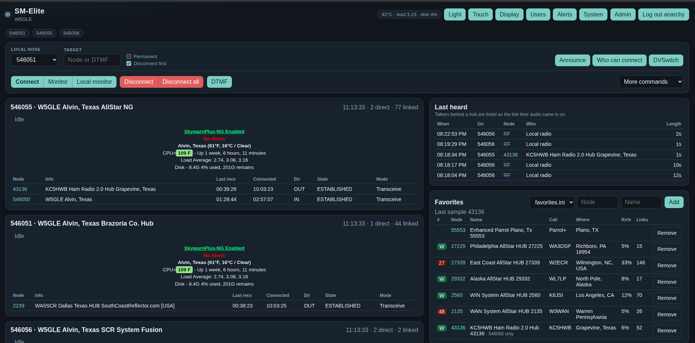

# SM-Elite

One AllStar dashboard that keeps the part of each existing monitor that is actually good at its job.

| From | What SM-Elite keeps |
| --- | --- |
| Allmon3 | One process owns AMI and pushes full JSON snapshots. Monitoring is open, control requires a login. Transmit state is local, network, telemetry, playback, or idle. Voters are data, not HTML. |
| AllScan | Favorites use the Supermon `label[]` / `cmd[]` file. Activity (transmit percent, Rx%, link count) comes from the AllStar stats service, paced once on the server, without connecting to those nodes. |
| supermon-ng | Connect, monitor, local monitor, disconnect, permanent links, DTMF, and command templates on one bar. The node status block (CPU, weather, SkywarnPlus alerts, disk) is shown as the node reports it. One websocket carries every node. |

Everything is original code. The pieces that age badly stay out: per-button PHP permission files, HTML built inside the poller, a websocket port per node, one AMI session per browser, and shell commands as the control path.

<p align="center">
  <a href="images/sm-elite-main.png" title="Click to enlarge">
    
  </a>
  <br>
  <sub>Click the screenshot to see it full size.</sub>
</p>

## Features

- **Live node cards** with every connected link, direction, mode, and transmit state, plus the Supermon-style status block.
- **Control bar**: connect, monitor, local monitor, disconnect, disconnect all, DTMF, and command templates from `commands.ini`.
- **Last heard**: who keyed up, on which node, and for how long, kept for 30 days. The panel shows the latest 5 by default.
- **Display**: each browser picks which panels, node-card lines, and connection columns it shows, plus how many last heard rows. Handy for a kiosk screen that only needs the node cards.
- **Find a node**: search the AllStar node directory by callsign, city, hub name, or number.
- **Favorites** from a Supermon `favorites.ini`, with live activity for each favorite.
- **Link map**: a diagram of each node's connections, folded into its card.
- **Who can connect**: edit the node's allow and deny lists, and drop a denied node that is linked right now.
- **Announce**: type text and play it with Piper text-to-speech, on this node only or on every connected link. Save announcements and replay them later.
- **DVSwitch**: switch a bridged node between DMR, YSF, P25, NXDN, D-STAR, and the other DVSwitch modes, pick a talkgroup from your list or type one, and restart the bridge services.
- **Keyup alerts**: a chime, an on-page notice, and (over HTTPS) a desktop notification when someone keys up on the nodes you pick.
- **System**: OS, CPU, memory, disks, temperature, addresses, service status, AllStar packages, and the Asterisk database.
- **Admin**: reload or restart Asterisk, reboot or power off the server, edit `rpt.conf`, `iax.conf`, and `extensions.conf` with automatic backups, compare and restore backups, and read the Asterisk log.
- **Users**: viewers watch, operators control nodes (optionally limited to certain node numbers), and admins also manage users and the admin tools.

## Try it

```bash
python3 -m smelite
```

Open http://127.0.0.1:8420/ . The shipped config is in demo mode, so the page runs with synthetic nodes and no Asterisk. The first visit asks you to create the admin account.

Requires Python 3.11 or newer and aiohttp (`apt install python3-aiohttp` on Debian).

## Install on a node (Debian package)

On an AllStarLink 3 node (Debian 12 or 13), add the [hardenedpenguin apt repository](https://hardenedpenguin.github.io/hardenedpenguin-apt/) once, then install:

```bash
cd /tmp
curl -fsSLO https://hardenedpenguin.github.io/hardenedpenguin-apt/pool/main/h/hardenedpenguin-archive-keyring/hardenedpenguin-archive-keyring_1.2_all.deb
sudo apt install ./hardenedpenguin-archive-keyring_1.2_all.deb
sudo apt update
sudo apt install sm-elite
```

The `.deb` is also attached to each [GitHub release](https://github.com/hardenedpenguin/sm-elite/releases) for `sudo apt install ./sm-elite_<version>_all.deb`.

Then open `http://<node>/sm-elite/`. On an ASL3 appliance, port 80 forwards to HTTPS, so you land on `https://<node>/sm-elite/`. The first visit asks you to create the admin account. That needs the one-time setup code the install prints, which is also in `/var/lib/sm-elite/setup-code` (`sudo cat` it), so nobody else who reaches the page first can claim the node.

The package:

1. pulls in `python3-aiohttp`, `apache2`, and `sudo`
2. creates the `smelite` system account the dashboard runs as
3. reads the node numbers and callsign from `/etc/asterisk/rpt.conf` and the AMI login from `/etc/asterisk/manager.conf`, and writes `/etc/sm-elite/smelite.ini` and `nodes.ini` (readable only by root and the `smelite` group; the AMI password is never printed)
4. picks up an existing Supermon `favorites.ini` when it finds one
5. starts the `sm-elite` service on `127.0.0.1:8420` and publishes it through Apache at `/sm-elite/` on ports 80 and 443
6. turns on the admin tools through `/usr/lib/sm-elite/smelite-admin` and its sudoers rule (set `[admin] enabled = no` to turn them off)

**Updating**: `sudo apt update && sudo apt upgrade`, or install the newer release file the same way. Your config, users, and history are kept and the service restarts on the new version.

**Removing**: `sudo apt remove sm-elite` keeps `/etc/sm-elite` and `/var/lib/sm-elite`; `sudo apt purge sm-elite` deletes them too.

| Path | What |
| --- | --- |
| `/etc/sm-elite/` | `smelite.ini`, `nodes.ini`, `dvswitch.ini`, favorites, command templates |
| `/var/lib/sm-elite/` | users, sessions, last heard, node directory cache |
| `/usr/share/sm-elite/` | the program and the example config files |
| `/etc/apache2/conf-available/sm-elite.conf` | the `/sm-elite/` proxy |

Logs: `journalctl -u sm-elite`.

### Building the package

```bash
sudo apt install debhelper python3-aiohttp
./deploy/build-deb.sh
```

The `.deb` lands in `dist/`. The build runs the test suite first. Bump the version in both `debian/changelog` (`dch -v <version>`) and `smelite/__init__.py`; the script refuses to build when they differ.

### Releasing

Push a tag that matches the changelog version, for example `git tag v0.2.8 && git push origin v0.2.8`. The Release workflow tests on Debian 12, builds on Debian 13, attaches the `.deb` to a GitHub release, and asks the hardenedpenguin apt repository to publish it. That last step needs the `APT_REPO_DISPATCH_TOKEN` repository secret; without it the release still succeeds and the apt repository picks the package up on its daily run.

## HTTPS

`deploy/apache-sm-elite.conf` proxies `/sm-elite/` to the dashboard on `127.0.0.1`, including the websocket. It works inside the existing ASL3 Apache site, so it shares that site's certificate. The stock certificate is self-signed, so browsers warn once. With a real hostname, `certbot --apache` replaces it.

Over HTTPS the session cookie is `__Secure-smelite` (Secure, HttpOnly). Desktop notifications for keyup alerts need HTTPS.

The dashboard trusts `X-Forwarded-For` and `X-Forwarded-Proto` only from the addresses in `[server] trusted_proxies` (default `127.0.0.1, ::1`).

## Configuration

`smelite.ini`, with paths relative to the file's own folder:

| Section | Keys |
| --- | --- |
| `[server]` | `listen` (comma-separated), `port`, `public` (`read` lets anyone watch, `none` requires a login), `data_dir`, `demo`, `trusted_proxies` |
| `[site]` | `title`, `callsign`, `location`, `welcome` |
| `[nodes]` | `file`: AMI logins in Allmon3 / supermon-ng stanza format (`host`, `port`, `user`, `pass` or `passwd`, `voters`, `multinodes`) |
| `[favorites]` | `directory` holding Supermon-style `favorites.ini` files |
| `[commands]` | `file` with the command templates for the More commands menu |
| `[database]` | `url`, `file`, `private` (your own node names), `refresh_minutes` for the AllStar node directory |
| `[stats]` | `enabled`, `min_gap_seconds` between AllStar stats requests |
| `[history]` | `enabled`, `keep_days` for last heard |
| `[admin]` | `enabled`, `config_dir` (`/etc/asterisk`), `log_file`, `helper` |
| `[sounds]` | `directory`, `voices` (Piper `.onnx` models), `piper`, `sox`, `max_chars` |
| `[system]` | `services` to show on the System page |
| `[dvswitch]` | `file` with the DVSwitch bridges and talkgroups (default `dvswitch.ini`) |

Text-to-speech needs `piper` and `sox` on the node and at least one voice in `/var/lib/piper-tts`. Without them the Announce dialog still plays saved sounds.

## DVSwitch

For a node with a DVSwitch bridge (Analog_Bridge and MMDVM_Bridge), edit `/etc/sm-elite/dvswitch.ini` (the package puts a commented copy there):

```ini
[node 1999]
abinfo = /tmp/ABInfo_34001.json

[network brandmeister]
label = BrandMeister
password = your-hotspot-password
server = 3102.master.brandmeister.network
port = 62031

[mode DMR]
BM Texas = @brandmeister 3148
BM Parrot = @brandmeister 9990#

[mode YSF]
America Link = americalink.hamfm.com:42000
```

A DVSwitch button then appears in the control bar for that node. SM-Elite talks to Analog_Bridge directly on the control port listed in its ABInfo file, the same messages `dvswitch.sh` sends, so it needs no shell scripts. Hotspot passwords stay in `dvswitch.ini` (readable only by root and the dashboard's group); the browser sees talkgroup names only, and talkgroups typed by hand cannot contain a password. Operators can switch modes and talkgroups; admins can also restart the `mmdvm_bridge*` and `analog_bridge*` services (second instances such as `analog_bridge2` included).

**Coming from supermon-ng:** when `/etc/supermon-ng/user_files/dvswitch_config.yml` exists, installing or upgrading the package writes `dvswitch.ini` from it: credential profiles become `[network]` sections, and every mode's talkgroups carry over. Each node with `rxchannel = USRP/127.0.0.1:<port>:...` in rpt.conf gets a `[node N]` section pointing at `/tmp/ABInfo_<port>.json` and the DVSwitch.ini next to the matching Analog_Bridge.ini (for example `/etc/dvswitch/2/` for a second bridge). This happens once, and only while `dvswitch.ini` has no `[node N]` section; the previous file is kept as `dvswitch.ini.before-import`. Per-node `dvswitch_config_<node>.yml` lists are not imported.

## Admin tools and root access

The dashboard runs as an ordinary account. Anything that needs root goes through one small script, `/usr/lib/sm-elite/smelite-admin`, which that account may run with `sudo` and nothing else. The helper:

- writes only `rpt.conf`, `iax.conf`, and `extensions.conf`, and only when the file still matches the version the editor loaded
- keeps the last 20 versions of each file in `/var/backups/smelite` (mode 600)
- saves and deletes announcements in the Asterisk sounds folder
- restarts the DVSwitch bridge services, and no other services
- schedules reboot and power off five seconds out, so the page can answer first

Every change made from the Admin page asks for the admin's password again.

## Layout

- `smelite/` the Python service: AMI, snapshots, stats cache, auth, history, admin, sounds, system info, DVSwitch
- `web/` the dashboard (plain HTML, CSS, and JavaScript, with no build step)
- `config/` demo config and examples
- `debian/` Debian packaging
- `deploy/` package build script, config generator, Apache snippet, root helper
- `data/` SQLite users, sessions, last heard, and the node directory cache for the demo
- `images/` screenshots for this README

Node snapshots, last heard, and the favorites scan arrive on `/ws`. Commands are `POST /api/command` and stay off the socket.

## Tests

```bash
python3 -m unittest discover -s tests
```

## Thanks

SM-Elite exists because these projects showed what a good AllStar dashboard looks like. Thank you to their developers:

- **[Allmon3](https://github.com/AllStarLink/Allmon3)** by Jason McCormick, N8EI, and the AllStarLink team, for the single-poller design, JSON snapshots, and the clear split between watching and controlling a node.
- **[AllScan](https://github.com/davidgsd/AllScan)** by David Gleason, NR9V, for favorites with live activity from the AllStar stats service.
- **Supermon** by Tim Sawyer, WD6AWP, and later Paul Aidukas, KN2R, for the control bar, the `favorites.ini` format, and the node status block that every AllStar operator knows.
- **[supermon-ng](https://github.com/hardenedpenguin/supermon-ng)** for carrying Supermon forward, and for the DVSwitch mode and talkgroup layout SM-Elite imports.
- **[DVSwitch](https://dvswitch.org/)** by Mike Zingman, N4IRR, and Steve Zingman, N4IRS, for Analog_Bridge and MMDVM_Bridge.
- **[Piper](https://github.com/rhasspy/piper)** by Michael Hansen and the Rhasspy project, for the text-to-speech voices behind Announce.
- **[AllStarLink](https://www.allstarlink.org/)** and its volunteers, for the network and the ASL3 platform this runs on.
